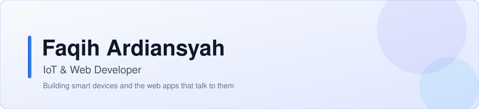

<!-- Header banner (adapts to light/dark theme) -->

  <picture>
    <source media="(prefers-color-scheme: dark)" srcset="assets/welcome-banner-dark.svg">
    
  </picture>

<!-- Tech stack badges -->

  
  
  
  
  
  

---

### About

Undergraduate developer focused on IoT and web development. Building smart devices and the web platforms that visualize their data, from an ESP32 air quality monitor to a smart insole for monitoring plantar pressure in diabetes patients.

<!-- GitHub stats (adapts to light/dark theme) -->

  <picture>
    <source media="(prefers-color-scheme: dark)" srcset="https://github-readme-stats.vercel.app/api?username=mofaqihardiansyah&show_icons=true&theme=transparent&hide_border=true&ring_color=818cf8">
    
  </picture>
  <picture>
    <source media="(prefers-color-scheme: dark)" srcset="https://github-readme-stats.vercel.app/api/top-langs/?username=mofaqihardiansyah&layout=donut&theme=transparent&hide_border=true">
    
  </picture>

  <picture>
    <source media="(prefers-color-scheme: dark)" srcset="https://streak-stats.demolab.com/?user=mofaqihardiansyah&theme=dark&hide_border=true">
    
  </picture>

---

### Featured Projects

| Project | Description | Language |
| --- | --- | --- |
| [Smart-Insole](https://github.com/mofaqihardiansyah/Smart-Insole) | Smart insole for monitoring plantar pressure in diabetes patients, with a web platform for data visualization | JavaScript |
| [SISC](https://github.com/mofaqihardiansyah/SISC) | Seminar and conference information system (MIT License) | TypeScript |
| [iot_air_quality_monitoring_tubes](https://github.com/mofaqihardiansyah/iot_air_quality_monitoring_tubes) | Web and Android app for monitoring and controlling air quality using ESP32 | HTML |

---

  

